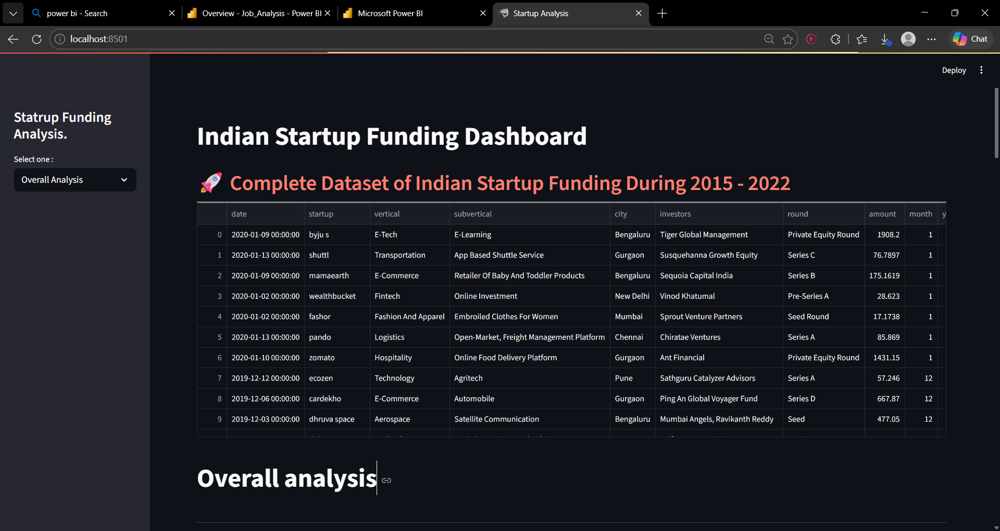
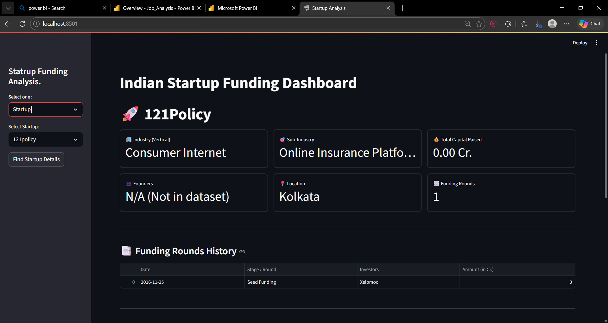
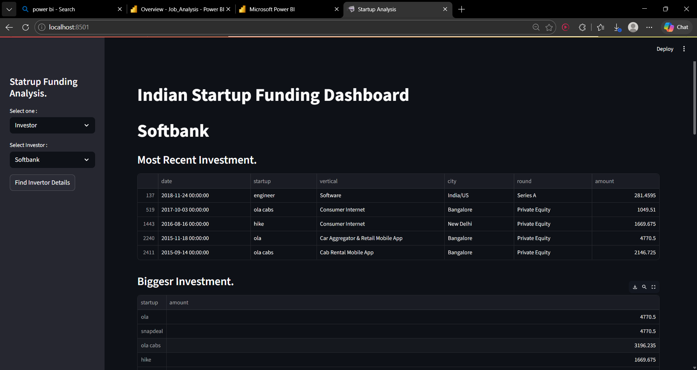

# 🚀 Indian Startup Funding Analytics & Intelligence Dashboard
### An End-to-End Data Pipeline & Interactive Streamlit Web Application (2015–2022)

---

## 📋 Table of Contents
- [Project Overview](#-project-overview)
- [Problem Statement](#-problem-statement)
- [Core Features & Perspectives](#-core-features--perspectives)
- [Tech Stack & Architecture](#-tech-stack--architecture)
- [Data Pipeline & Engineering](#-data-pipeline--engineering)
- [Dashboard Preview](#-dashboard-preview)
- [Repository Structure](#-repository-structure)
- [Installation & Setup](#-installation--setup)
- [Key Insights & Analytics](#-key-insights--analytics)
- [Future Enhancements](#-future-enhancements)
- [License](#-license)

---

## 📌 Project Overview

The Indian startup ecosystem experienced exponential transformation between 2015 and 2022. However, public records of funding rounds, acquisitions, and angel investments are notoriously fragmented, filled with conflicting string representations, uncleaned valuations, and unstructured entities.

This project delivers an **interactive data analytics web application** built with **Python, Pandas, and Streamlit**. It models over 3,000+ investment transactions to analyze funding distribution, investor behaviors, and startup lifecycles across three focused analytical perspectives: **Overall Ecosystem Analysis**, **Startup Deep-Dive**, and **Investor Portfolio Analysis**.

---

## ❗ Problem Statement

Raw investment datasets present several challenges:
- **Noisy & Inconsistent Entities:** Startup names appear under varying spellings, corporate suffixes (`Pvt Ltd`, `LLC`, `Inc`), and messy web URLs (`https://`, `.com`, `.in`).
- **Mixed Formats & Units:** Investment rounds are reported in non-standard currencies, irregular date encodings, and mixed stages (`Series A`, `Pre-Series A`, `Seed Round`).
- **Investor Disaggregation:** Multiple co-investors are frequently flattened into a single comma-separated string, making portfolio aggregation difficult without custom parsing algorithms.
- **Actionability:** Investors, founders, and market analysts lack a lightweight, multi-dimensional exploratory platform to evaluate historical sector trends, city-wise capital concentration, and round metrics in one unified interface.

---

## 🎯 Core Features & Perspectives

### 1. 🏢 Overall Market Analysis (Ecosystem POV)
- **Executive KPI Cards:** Dynamic metrics displaying **Total Capital Deployed (INR Cr.)**, **Maximum Single Round**, **Average Deal Size**, and **Unique Funded Startups**.
- **Month-over-Month (MoM) Velocity:** Dual-mode trend tracking (toggle between **Total Amount** and **Deal Count**) across timelines.
- **Sector Breakdown:** Top 10 verticals analyzed via cumulative capital distribution and transaction frequency.
- **Geographic & Stage Allocation:** City-wise distribution of funding and deal volume alongside stage categorization (Seed, Angel, Series rounds).
- **Year-over-Year (YoY) Capital Heatmap:** Cross-tabulation of funding volume by sector and investment year.

### 2. 🚀 Startup Profile (Company POV)
- **Company Metadata:** Cleaned corporate profiles highlighting Founders, Industry, Sub-vertical, and Operational Headquarters.
- **Round-by-Round History:** Chronological ledger detailing funding stages, dates, participating venture partners, and ticket sizes.
- **Automated Competitor Discovery:** Real-time extraction of similar industry peers and their funding footprint to benchmark valuation and vertical competition.

### 3. 💼 Investor Portfolio (Investor POV)
- **Portfolio Summary:** Recent deal logs and historical marquee investments ranked by round size.
- **Sector & Geographic Preference:** Categorical breakdown (Seaborn & Matplotlib) visualizing capital allocation across industries and cities.
- **Investment Stage Distribution:** Stage preference distribution (Angel vs. Late Stage).
- **Temporal Deal Trajectory:** Year-over-Year funding trajectories to monitor investment momentum.
- **Co-investor & Similar Investor Mapping:** Behavioral profiling based on shared industry verticals and investment tiers.

---

## 🛠 Tech Stack & Architecture

| Layer | Tools & Libraries | Purpose |
|---|---|---|
| **Language** | Python 3.10+ | Core data processing and business logic |
| **Web Framework** | Streamlit | Reactive dashboard state management and UI |
| **Data Processing** | Pandas, NumPy | Vectorized transformations, aggregation, regex cleaning |
| **Data Visualization** | Matplotlib, Seaborn, Plotly Express | Categorical, relational, and distribution charting |
| **Data Storage** | Processed CSV / Parquet | Local optimized storage layers |

### High-Level Architecture Flow


```

┌───────────────────────────────┐
│       Raw Data Sources        │
│   startup_funding.csv (raw)   │
└──────────────┬────────────────┘
│
▼
┌───────────────────────────────┐
│     Data Cleansing Engine     │
│   • Regex URL & suffix scrub  │
│   • Date & currency parsing   │
│   • Multi-investor unnesting  │
└──────────────┬────────────────┘
│
▼
┌───────────────────────────────┐
│     Processed Data Layer      │
│     startup_cleaned.csv       │
└──────────────┬────────────────┘
│
▼
┌─────────────────────────────────────────────────────────┐
│                 Streamlit Engine (app.py)                │
├───────────────────┬───────────────────┬─────────────────┤
│  Overall Analysis │  Startup Details  │ Investor Profile│
│  • MoM Trends     │  • Round History  │ • Portfolio Sum │
│  • Sector Split   │  • Peer Discovery │ • Stage/City Pie│
│  • City Wise Heat │  • Founders/HQ    │ • YoY Trajectory│
└───────────────────┴───────────────────┴─────────────────┘

```

---
## 🖼 Dashboard Preview

### 1. Overall Ecosystem Overview & Funding Velocity


### 2. Sector & Geographic Capital Allocation


### 3. Investor Portfolio & Startup Drill-Down



---

## 📁 Repository Structure


```

startup_funding_case_study/
├── 📂 assets/
│   ├── startuo_funding_img_01.png
│   ├── startuo_funding_img_02.png
│   └── startuo_funding_img_03.png
│
├── 📂 data/
│   ├── 📂 raw/
│   │   ├── indian_startup_funding_2020_2025_sample.csv
│   │   └── startup_funding.csv
│   └── 📂 processed/
│       ├── startup_cleaned.csv
│       └── startup_cleaned_new.csv
│
├── 📂 docs/
│   └── Streamlit Project.pdf
│
├── 📂 notebooks/
│   ├── indian_startup_funding_2020_2025.ipynb
│   └── startup-data-analysis_ORG.ipynb
│
├── .gitignore
├── app.py
├── README.md
└── requirements.txt

```

---

## ⚙️ Installation & Setup

### 1. Clone the Repository
```bash
git clone [https://github.com/your-username/startup_funding_case_study.git](https://github.com/your-username/startup_funding_case_study.git)
cd startup_funding_case_study


### 2. Configure Virtual Environment

```bash
# Windows
python -m venv myvenv
myvenv\Scripts\activate

# macOS / Linux
python3 -m venv myvenv
source myvenv/bin/activate

```

### 3. Install Dependencies

```bash
pip install -r requirements.txt

```

### 4. Run the Streamlit Application

```bash
streamlit run app.py

```

Open `http://localhost:8501` in your browser.

---

## 📊 Key Insights & Analytics

* **Geographic Clustering:** Bengaluru, Mumbai, and Delhi-NCR account for more than 70% of total capital inflow across the analyzed period.
* **Sector Rotation:** FinTech and E-commerce consistently dominate aggregate dollar volume, with significant post-2020 acceleration in EdTech and SaaS.
* **Late-Stage Concentration:** Over 60% of absolute dollar value is concentrated within top-decile mega-rounds, while Seed and Angel rounds drive total deal count.

---

## 🚀 Future Enhancements

* [ ] **Predictive Valuation Engine:** Machine learning models to predict subsequent round sizing based on early-stage velocity and sector metrics.
* [ ] **Interactive Network Graph:** Graph database (NetworkX / PyVis) visualizer connecting co-investors and shared portfolio syndicates.
* [ ] **Automated PDF Diligence Reports:** One-click executive PDF export for individual startup and investor profiles.

---

## 📄 License

This repository is distributed under the **MIT License**. Dataset information is compiled and sanitized for academic research and portfolio purposes.

```

```
